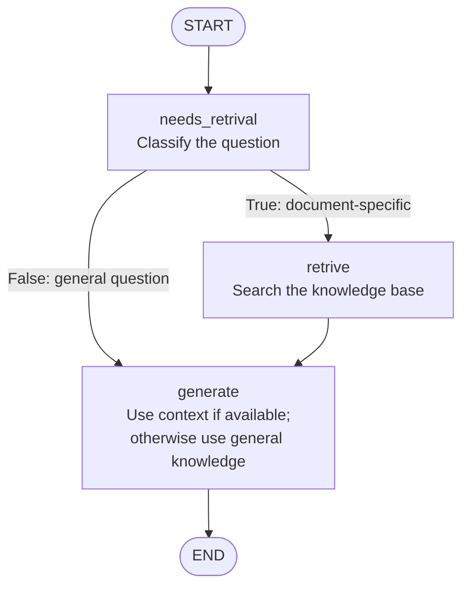

# Agentic RAG

> A local-first RAG project that classifies each question and retrieves
> knowledge-base context only when the question needs it.

This project explores two retrieval-augmented generation workflows over
WebVTT (`.vtt`) transcript files. The main example, [`1_agentic_rag.py`](./1_agentic_rag.py),
uses a LangGraph router to choose whether a question should use the transcript
knowledge base or be answered directly from the language model's general
knowledge.

## At a glance

- **Conditional retrieval:** document-specific questions use semantic search;
  general questions skip retrieval.
- **Grounded answers:** when retrieved context is used, the model is instructed
  to answer from that context and say it does not know if the answer is absent.
- **Local inference:** routing and answer generation use Ollama with `Qwen3:4b`.
- **Inspectable workflow:** the script prints the routing decision, retrieved
  documents, context, and final answer.

## Workflow

The diagram follows the LangGraph workflow shown in the project:



### What each node does

| Node | Responsibility |
| --- | --- |
| `needs_retrival` | Sends the query to `Qwen3:4b` and parses a structured `needs_retrieval` boolean. It classifies whether the question requires specialized documents or can be answered generally. |
| `retrive` | Runs a similarity search against the in-memory Chroma vector store, returns the top 3 chunks, and joins their text into the context. This node runs only when the router returns `True`. |
| `generate` | If retrieved context exists, asks the model to answer using that context and say “I don't know” when the answer is not present. If there is no context, answers the general question directly. |
| `START` / `END` | Mark the entry and completed response of the LangGraph workflow. |

**Important distinction:** the router decides whether retrieval should happen;
it does not first search the knowledge base to prove that an answer exists.
For a document-specific question, retrieval returns the closest available
chunks, and the answer prompt asks the model to stay grounded in those chunks.

## How the knowledge base is prepared

1. [`documents_loader.py`](./documents_loader.py) loads all `.vtt` files from
   `data/`.
2. It removes WebVTT headers and timestamps, then splits transcript text into
   chunks of 1,000 characters with 150 characters of overlap.
3. `sentence-transformers/all-MiniLM-L6-v2` creates embeddings for the chunks.
4. Chroma stores those embeddings in memory for similarity search during that
   run.

The vector store is rebuilt each time the script starts; it is not saved
between runs.

## Getting started

### Requirements

- Python 3.13 or newer
- [uv](https://docs.astral.sh/uv/)
- [Ollama](https://ollama.com/) installed and running locally

### Install

```bash
git clone https://github.com/Yakub019/Agentic-Rag.git
cd Agentic-Rag
uv sync
ollama pull Qwen3:4b
```

Start Ollama if it is not already running as a background service:

```bash
ollama serve
```

### Run the conditional retrieval workflow

```bash
uv run python 1_agentic_rag.py
```

The query is currently set in the `test_query` variable near the bottom of
[`1_agentic_rag.py`](./1_agentic_rag.py). Change it to try your own question.
For example:

```python
test_query = "What are the evaluation steps for a RAG application?"
```

The script prints the answer, routing decision, retrieved document metadata and
content, and the context supplied to the answer-generation step.

### Run the basic RAG workflow

[`main.py`](./main.py) is the earlier, non-conditional example: it retrieves
transcript chunks for its query and passes them to the answer model.

```bash
ollama pull Qwen3:1.7b
uv run python main.py
```

## Models and configuration

| Component | Configuration |
| --- | --- |
| Router and answer model in `1_agentic_rag.py` | Ollama `Qwen3:4b` |
| Answer model in `main.py` | Ollama `Qwen3:1.7b` |
| Embeddings | Hugging Face sentence-transformers `all-MiniLM-L6-v2` |
| Vector store | Chroma, created in memory |
| Retrieval count | Top 3 chunks |
| Chunking | 1,000 characters; 150-character overlap |

Both Python scripts also initialize a Hugging Face endpoint object, but the
current graph's routing and answer chains use Ollama. The Hugging Face endpoint
is not used to produce the workflow's answers.

## Project structure

```text
.
├── 1_agentic_rag.py       # Conditional router → retrieval/generation graph
├── main.py                # Basic retrieve-then-generate RAG example
├── documents_loader.py    # WebVTT loading, cleanup, and chunking
├── data/                  # Transcript knowledge base (.vtt files)
├── pyproject.toml          # Project metadata and dependencies
└── uv.lock                 # Locked dependency versions
```

## Current scope

- The knowledge base currently uses local `.vtt` transcripts in `data/`.
- Chroma is rebuilt in memory on each run; persistent indexing is not configured.
- The question is edited in the Python script; there is not yet a web UI or API.
- The router is an LLM classification step, so its decision depends on the
  model's classification.

## Data note

Only add or publish transcripts that you have permission to use and share.
